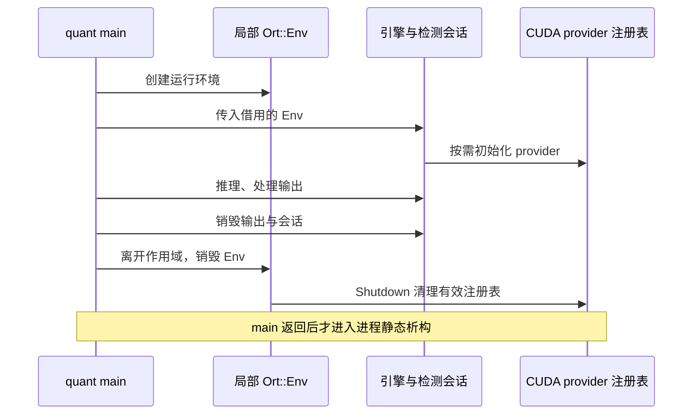

# Quantization — YOLO 部署硬化与 INT8 评估 Harness

> Phase 0 交付物 `quant`：INT8 PTQ、部署硬化、评估 harness 与 coco128 精度评估已完成。
> 2026-09-10 补齐五轮基准、Nsight 设备 trace 与 ORT 分配证据；2026-09-11 已修复 quant 入口退出 UAF，旧默认入口迁移另列遗留。

通用概念见主题库：

- ORT / EP / IOBinding / YOLOv8 检测头 / NMS / INT8 PTQ / MinMax / Entropy / backbone 与检测头：[`docs/notes/inference.md`](../../docs/notes/inference.md)
- Letterbox、BGR/RGB、坐标反算：[`docs/notes/image-ops.md`](../../docs/notes/image-ops.md)
- profiling 方法、P50/P99、benchmark 边界、部署硬化 vs 后端优化、EvalHarness：[`docs/notes/systems-perf.md`](../../docs/notes/systems-perf.md)

## 模块定位

`quantization/` 不复制 W16 的 YOLO core，而是包装 W16/W14：

- W16 继续负责预处理、ORT 推理、YOLOv8 decode、NMS 和 ultralytics 对拍基线。
- W16 只做加性扩展：`DecodeOptions`、`NmsOptions`、`DetectorConfig` 部署配置、`DetectWithProfile()`。
- quant 负责部署评估 harness：滚动 P50/P99、多模型 FP32/INT8 切换、batch consistency、Markdown benchmark/report。

## 概念边界速查

- **INT8** 是量化后的数值格式，不等于「量化精度」。真正的精度看 mAP、框级一致性、score 差异等任务指标。
- **MinMax / Entropy** 是 static PTQ 的 calibration 策略，负责给激活选择量化范围；MinMax 取观测 min/max，Entropy 用 histogram + KL 选择信息损失较小的 clipping 阈值。⚠️ ORT `quantize_static` 默认参数下 Entropy 实测退化为 MinMax（本模块两 INT8 产物字节级相同，2026-07-11 勘误），机制见主题库坑 ③。
- **backbone / 检测头** 是模型结构分工。backbone 提特征且是算力大头，检测头输出框坐标与类别分数；本模块排除 `/model.22/` 是让检测头保 FP32，避免分数被坐标量纲撑大的 scale 压没。
- **部署硬化** 是让推理路径更稳、更可测：`max_det`、NaN/Inf skip、`reserve`、fallback reason、分段计时、P50/P99、batch consistency。TensorRT、FP16 engine、GPU 端前后处理融图属于后续 `trt` 的后端优化。
- **harness** 是评估框架，不是模型也不是量化算法；它把多个模型 case 放进同一套 W16 检测流水线，统一 warmup、正式迭代、延迟统计和报告输出。

## 数据流

```mermaid
flowchart LR
  Img["输入图片"] --> Pre["BGR->RGB + LetterboxToTensor"]
  Pre --> Tensor["NCHW tensor"]
  Tensor --> Engine["W14 InferenceEngine"]
  Engine --> Raw["YOLO output [N,C,A]"]
  Raw --> Decode["W16 DecodeYolov8 + DecodeOptions"]
  Decode --> Nms["W16 Nms + NmsOptions"]
  Nms --> Result["DetectionResult"]
  Result --> Stats["RollingStats P50/P99"]
  Stats --> Report["quant_benchmark Markdown"]
```



## W16 vs quant

| 维度 | W16 baseline | quant hardening |
|---|---|---|
| 后处理 | `DecodeYolov8(conf)` + `Nms(iou)` | options overload，支持 NaN/Inf skip、reserve、`max_det` |
| 推理配置 | 默认 `Detect()` 路径 | `DetectorConfig` 透传线程数、IOBinding 和硬化项 |
| 计时 | benchmark 一次性三段测量 | `DetectWithProfile()` + `RollingStats` |
| batch | W16 benchmark 证明 batch=4 能跑 | `Quant_BatchConsistencyTest` 验证 batch=4 每片与 batch=1 一致 |
| 报告 | W16 工程快测 | `docs/benchmarks/quant_yolo_hardening.md` 记录 baseline vs hardened |

## 组件

```
quantization/
  rolling_stats.{hpp,cpp}       # 固定窗口 P50/P99
  eval_harness.{hpp,cpp}        # 多模型评估：warmup + iters + fallback reason
  quant_benchmark.cpp           # Markdown benchmark CLI
  batch_consistency_test.cpp    # batch=1 vs batch=4 输出切片一致性
  *_test.cpp                    # GoogleTest 单测
```

## 测试与 Benchmark

```bash
cmake -S . -B build -G Ninja
cmake --build build --target quant_rolling_stats_test quant_eval_harness_test quant_batch_consistency_test quant_int8_consistency_test quant_benchmark
ctest --test-dir build -R "Quant_" --output-on-failure
./build/02_Inference_Analysis/quantization/quant_benchmark
```

使用 CPU ORT 包时，`quant_benchmark` 会显式打印 CUDA fallback reason；GPU 包也可能因当前会话访问限制而回退，需以“实际 EP”和 reason 为准。第一阶段历史实测见
[`docs/benchmarks/quant_yolo_hardening.md`](../../docs/benchmarks/quant_yolo_hardening.md)。

## INT8 PTQ

```bash
cmake -S . -B build -G Ninja -DPython3_EXECUTABLE="$PWD/.venv/bin/python"
systemd-run --user --scope -p MemoryMax=5G -p MemorySwapMax=4G \
  cmake --build build --target quant_yolov8_static
./build/02_Inference_Analysis/quantization/quant_benchmark \
  02_Inference_Analysis/w16_yolo_detector/models/test_image.jpg \
  02_Inference_Analysis/w16_yolo_detector/models/yolov8n.onnx \
  build/02_Inference_Analysis/quantization/models/yolov8n.int8.minmax.onnx \
  build/02_Inference_Analysis/quantization/models/yolov8n.int8.entropy.onnx
```

FP32/INT8 第一版报告见
[`docs/benchmarks/quant_int8_report.md`](../../docs/benchmarks/quant_int8_report.md)（已按头部保 FP32 版本重跑刷新，2026-07-02）。

默认校准最多 32 图，优先 `QUANT_CALIB_DIR` 指定的 coco128 目录，缺目录时回退单图工具链验证。
`QUANT_CALIB_LIMIT=0` 表示显式不限量；32 图限制不能替代进程内存约束。
`QUANT_MODELS_DIR` 默认在各 build 的模块目录下，GPU 构建可将它指向现有 CPU build 的产物目录，
无需重复校准。完整命令见 [环境指南](../../docs/setup.md#quant-额外依赖ort-static-int8-ptq第二阶段量化)。

2026-09-10 修复了测试辅助函数 skip 后调用者仍继续加载模型的问题：全部缺模型/图时，
9 个依赖产物的用例正确跳过；仅缺 INT8 时，2 个一致性用例正确跳过。有模型时原 32 个
W16/Quant GTest 用例通过，新增 4 个 Python 参数用例通过。`build-gpu` 复用现有模型后，
两项 INT8 一致性用例也实际通过；它们指定 CPU EP，不是 GPU 可用性证明。

### INT8 0 检测框根因与修复（2026-07-02 闭环）

- **症状**：首版 INT8 模型（MinMax/Entropy）单图评估输出 0 检测框，top score 恰为 0.0000。
- **根因**：整图量化把检测头也做了激活量化。YOLOv8 输出张量 (1,84,8400) 混合框坐标
  （0~640）与类别分数（0~1），最终 Concat 输出的 per-tensor scale≈637/255≈2.5——
  所有 <2.5 的分数只能取 0，全部类别分数坍缩，**与校准集大小无关**（校准图即评估图也复现）。
  证据：INT8 输出仅 256 个离散值，`output0_DequantizeLinear` scale=2.499。
- **修复**：`quantize_yolov8_static.py` 默认 `--exclude-pattern "/model.22/"`，检测头
  154 节点保 FP32；校准集从单图扩为 coco128（`--calib-dir`，
  `--calib-limit 32`）。
- **代价**：模型体积 3.9M → 6.5M（压缩率 29% → 50%），头部 FP32 换检测可用。
- **验证**：`Quant_Int8ConsistencyTest`——FP32 高置信框（score≥0.5）必须在 INT8 结果中
  有同类别 IoU≥0.7、分数差≤0.15 的匹配；修复前红（0 框触发断言）、修复后绿。
- **内存约束**：Entropy 校准会在内存中累积全部中间层输出做直方图，32 图峰值 RSS
  **5.24GB**；本机 WSL 仅 7.7GB，量化必须用 `systemd-run --user --scope -p MemoryMax=5G
  -p MemorySwapMax=4G` 包内存墙跑（裸跑曾多次打崩 WSL VM），被杀时降 `--calib-limit`
  而不是提高上限。校准 reader 已改懒加载（逐张预处理，不全量驻留）。

## 当前边界

- `use_iobinding=true` 走 W14 `RunIoBinding`：已做**输出持久绑定** + **输入零拷贝借用**。
  Run vs IOBinding 在 **CPU 与 GPU（CUDA EP）实测均为噪声级**（GPU 用 `build-gpu` 实测：FP32
  5.64/5.67ms、INT8 两模型优劣翻转）。现有路径未展示稳定收益，因此暂不投入完整双绑
  （device buffer/pinned/异步 D2H）；完整方案尚未实现，其收益未知。
- INT8 GPU：历史 CUDA EP 测量中 INT8（QDQ）比 FP32 慢约 2×（5.64ms vs ~11ms）。
  2026-09-10 已补分析：卷积仍用 float，增加 473 个 GPU Q/DQ kernel 与 45 次偏置小拷贝；
  设备拷贝耗时相近，不能简单归因于带宽。现有 IOBinding 未减少这些工作；后续由 TRT 验证
  实际 INT8 加速，见 [新报告](../../docs/benchmarks/quant_profiling_report.md)。
- `reserve_hint` 已覆盖结果等价，但每帧仍新建 vector，未测分配次数；不能声称消除了逐帧分配。
  仅在后续剖析显示 decode/分配值得投入时，再做 reserve=0/512 的单项测量，本轮不引入 allocator 或内存池。
- ~~INT8 精度失败样本（0 检测框）~~ 已闭环，见上节根因与修复。
- INT8 精度：单图框级一致性 + coco128 mAP 均已跑通。coco128 mAP50-95 FP32 0.4454
  → INT8 0.4285（掉约 1.7 点；MinMax=Entropy 是因为两产物字节级相同——ORT Entropy
  校准默认参数退化为 MinMax，2026-07-11 勘误，见 `quant_int8_report.md`），
  `tools/eval_map_coco128.py`（ultralytics `model.val`）。评估是逐张推理不吃内存，
  与 Entropy 校准的内存墙无关。
  `quant_int8_report.md` 的延迟/体积/mAP 数字已按头部保 FP32 版本刷新（2026-07-02）。

## 运行时生命周期（2026-09-11）

quant benchmark 在 `main` 开头创建局部 `Ort::Env`，向纯推理的 `SessionConfig`
以及流水线的 `EvalConfig.detector.env` 传递同一指针。检测器继续透传给引擎；
quant eval 测试也显式持有 Env，避免 CPU 用例初始化旧 static Env 后影响 CUDA 用例。
通用概念见 [主题库](../../docs/notes/inference.md#ortenv-共享与退出顺序)。



`Quant_RuntimeLifetimeTest` 默认执行真实 CPU 推理、IOBinding、单图检测和 harness，
以独立进程覆盖正常退出。`--cuda-registry` 模式只构造引擎/检测器，再初始化 CUDA
注册表，供 Valgrind 快速对照清理顺序；这个诊断模式不执行神经网络推理。
缺资产返回 77，CTest 标为跳过；CUDA 诊断模式还会检查 ORT 是否包含 CUDA EP。

三轮完整 GPU 基准均正常退出，相关 10 个 CTest 目标通过。Valgrind 目标退出 UAF
上下文从 2 降为 0，其他 WSL 驱动映射读报告保留。原具体 SIGABRT 未再次捕获，
也未完成长期运行验证。旧 W14/W16 默认入口仍走兼容的 static Env，另列技术债；
详细证据与复现命令见 [生命周期报告](../../docs/benchmarks/quant_runtime_lifetime.md)。

## Profiling 入口与采集边界

普通 benchmark 默认关闭 NVTX，现用 warmup=20、iters=200，harness 统计窗口也为 200。
可选标记只包围纯推理的正式测量循环，排除模型创建和预热；标签包含模型名、实际 EP 与
Run/IOBinding 模式。历史 warmup=5/iters=20 的数字不改写为新配置结果。

2026-11-16 起 harness 每次 `Run()` 只解码一次输入图（此前每轮迭代都 `imread`，不计入分段计时），
默认参数完整基准墙钟 61.0→54.4 s。迭代间少了解码空隙、GPU 提交更紧凑，CUDA 端到端可能略低于旧口径；
单轮 A/B 分不出该效应与噪声（改后 FP32 total P50 10.05/9.49 ms，旧口径五轮范围 9.69–10.16/10.03–10.66 ms），
跨日期对比时留意。

按 README 准备 NVTX v3.2.2 头文件后，可单独构建：

```bash
cmake -S . -B build-quant-profile -G Ninja -DCMAKE_CXX_COMPILER=g++-15 \
  -DCMAKE_BUILD_TYPE=Release -DQUANT_ENABLE_NVTX=ON \
  -DQUANT_NVTX_INCLUDE_DIR="$PWD/build/quant-tools/NVTX-3.2.2/c/include" \
  -DONNXRUNTIME_ROOT="$PWD/third_party/onnxruntime/onnxruntime-linux-x64-gpu-1.26.0"
cmake --build build-quant-profile --target quant_benchmark -j2
```

已验证 NVTX 关闭/开启两种构建均成功。2026-09-10 初始受限会话缺少 `/dev/dxg`，
切换执行权限后 CUDA 初始化和真实推理通过；随后安装 Nsight 2025.1.3，并按 README
设置 WSL 的 CUPTI 时间戳转换，已生成包含 kernel / memcpy 的 `.nsys-rep` 与 SQLite。
五轮基准、分区统计、ORT 节点分配、GPU 硬化 before/after 和边界统一见
[性能瓶颈报告](../../docs/benchmarks/quant_profiling_report.md)。本次未重跑 mAP。
当日一次额外基准尝试在退出时发生堆损坏，已排除并保留日志；后续定位与修复见
[生命周期报告](../../docs/benchmarks/quant_runtime_lifetime.md)，历史性能表保持原日期。

在 GPU 可访问且按 [NVIDIA 官方指南](https://docs.nvidia.com/nsight-systems/UserGuide/index.html#installing-the-cli-on-your-target)
准备好 `nsys` 的会话中，先检查工具版本和 GPU，再执行采集。原始数据目录应使用新目录，
避免覆盖已有采集：

```bash
nvidia-smi
nsys --version
mkdir -p build/quant-closeout-evidence
nsys profile --trace=cuda,nvtx,osrt --sample=none --cpuctxsw=none \
  --output=build/quant-closeout-evidence/quant \
  ./build-quant-profile/02_Inference_Analysis/quantization/quant_benchmark \
  02_Inference_Analysis/w16_yolo_detector/models/test_image.jpg \
  02_Inference_Analysis/w16_yolo_detector/models/yolov8n.onnx \
  build/02_Inference_Analysis/quantization/models/yolov8n.int8.minmax.onnx
nsys stats --report cuda_gpu_trace --format csv \
  build/quant-closeout-evidence/quant.nsys-rep \
  > build/quant-closeout-evidence/cuda-trace.csv
```

验收必须按 `fp32_CUDA_Run`、`yolov8n.int8.minmax_CUDA_Run` 及各自 IOBinding 区间归因。
记录计算、H2D/D2H/D2D 拷贝与同步；不能把全进程汇总分配给单一模型，也不能将并行事件时长
直接相加当作墙钟占比。性能对比使用无 profiler 的 5 轮原始输出，trace 只作归因，随后再补
GPU default/hardened 表。完整检查步骤见 [执行计划](../../docs/superpowers/plans/2026-09-10-quant-closeout.md)。

## CI 独立后续项

本轮格式检查已扩到 `01_Linux_CPP_Foundations/` 与 `02_Inference_Analysis/` 的受版本控制
C++ 文件。构建工作流仍使用 g++-13，未准备 ORT；不能认为 quant 已被自动编译/精度验收。
完整 CI 改造单独安排：固定 GCC 15/Ninja/CMake 环境、准备 CPU ORT、显式构建并检查 quant
测试清单，再区分无模型 skip 检查和有模型的真实一致性检查。无需每次 CI 重跑 Entropy 或配置
GPU runner，此项不阻塞 TRT 的本地开发。
