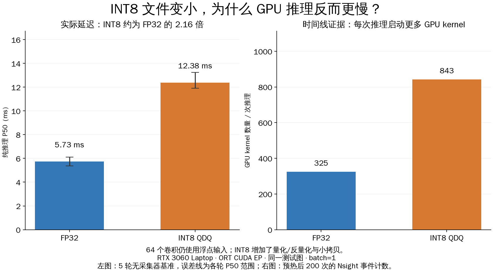

# Quant GPU 性能瓶颈分析（2026-09-10）

本报告补做 quant 的 FP32/INT8 对照 profiling，不改变历史上“量化前没有先 profiling”的事实。
范围为现有 ORT CUDA EP 与 CPU EP；没有修改推理实现、重新量化、重跑 mAP 或实现 TensorRT INT8。

**结论：当前 CUDA EP 的 INT8 QDQ 路径主要多花在转换 kernel、融合减少与大量小调用上，
没有得到整数卷积的收益。不能把约 2.16 倍的延迟简单归因于传输字节量。**
GPU kernel 数 325→843；H2D 虽然多 45 次，但只增加 17,728 字节/次推理。
现有 IOBinding 没有减少这些工作。后续优先验证 TensorRT 对 QDQ 的融合与实际精度层类型；
退出时偶发的堆损坏在当日另列稳定性问题。2026-09-11 已定位并修复 quant 入口的
退出 UAF，验证边界见 [后续报告](quant_runtime_lifetime.md)；本报告保留 09-10 的测量语境。



## 环境与方法

- 代码基线：`50173287ab8901b62fad6ea3d999a7b449d28d6b`；GCC 15、Ninja、Release、ORT GPU 1.26.0。
- GPU：RTX 3060 Laptop GPU，6144 MiB；Windows 驱动 546.30；CUDA toolkit 12.3.107；cuDNN 9.23.1.3。
- CPU：i5-12500H，WSL 可见 16 个逻辑处理器；Ubuntu 24.04.4，WSL2 kernel 6.6.87.2，内存约 7.8 GiB。
- Nsight Systems 2025.1.3.140，NVTX 3.2.2；安装命令及包 SHA-256 见 [环境指南](../setup.md#quant-可选nvtx-标记与-nsight-采集)。本轮未安装 perf / Nsight Compute。
- 固定同一测试图，输入 `[1,3,640,640]`；每组预热 20 次，测量 200 次；ORT intra/inter threads=0（默认），图优化 `ORT_ENABLE_ALL`。
- 性能数据来自 **5 个正常退出、无 profiler 的独立进程**；每轮沿用相同固定顺序。表中 P50/P99 是“各轮分位数的中位数”，不是将 1000 帧混合后的分位数；范围表示 5 轮 P50 的最小/最大值，不是置信区间。
- NVTX 只覆盖预热后的纯推理循环，每个区间 200 次。Nsight 采集 `cuda,nvtx,osrt`，关闭 CPU 采样和上下文切换；trace 用于分析事件及等待，不用于替代无 profiler 的延迟。
- 流水线计时覆盖 BGR/RGB、letterbox、NCHW、ORT、decode/NMS；**不含文件读取、JPEG 解码、模型初始化**。各阶段分位数不能直接相加作为 total 分位数。
- 所有正式 CUDA 行均实际启用 CUDA EP，所有流水线行都检出 5 框；这不是新的 mAP 评估，也不等于所有算子都在 GPU。

一次额外尝试在输出全部性能表后以 SIGABRT 退出，glibc 报 `corrupted double-linked list`。
该次保存在 `benchmark-3-aborted.log`，排除在上述 5 轮之外；之后补测正常，但**没有证明这个退出异常已修复**。
本报告的性能统计以成功完成为条件，不据此宣称长期运行稳定。

### 模型身份

| 模型 | 字节数 | SHA-256 |
|---|---:|---|
| FP32 | 13,025,942 | `20bbffb07fe901d17e939e5c9098023477e21651a9011c75d0aaeccc557633d7` |
| INT8 MinMax | 6,473,085 | `3d3a99ae89d76f0b8ef8bb625718fc47f94b6686faaffaf802fe822f50993abb` |

INT8 检测头仍保留 FP32；Entropy 与 MinMax 历史产物字节相同，本次不重复测同一模型。

## 无 profiler 的五轮结果

### 纯 ORT 推理

| 模型 | 实际 EP | 调用 | P50 中位数（ms） | 五轮 P50 范围（ms） | P99 中位数（ms） |
|---|---|---|---:|---:|---:|
| FP32 | CPU | Run | 47.67 | 44.81–48.61 | 54.60 |
| FP32 | CPU | IOBinding | 46.29 | 45.17–46.98 | 52.25 |
| FP32 | CUDA | Run | 5.73 | 5.38–6.10 | 11.05 |
| FP32 | CUDA | IOBinding | 5.87 | 5.35–6.00 | 11.19 |
| INT8 | CPU | Run | 35.62 | 35.50–36.75 | 41.76 |
| INT8 | CPU | IOBinding | 35.69 | 35.01–37.24 | 43.03 |
| INT8 | CUDA | Run | 12.38 | 11.90–13.24 | 20.87 |
| INT8 | CUDA | IOBinding | 12.79 | 12.02–13.04 | 21.44 |

普通 Run 下，CPU INT8 较 FP32 快约 **25.3%**，CUDA INT8 的延迟却为 FP32 的 **2.16 倍**。
IOBinding 的逐轮差异会反转，不能宣称稳定加速；也不能从本次结果推断尚未实现的完整 device buffer / pinned memory 方案没有价值。

### GPU 流水线：默认配置与整体硬化

| 模型 | 配置 | pre P50 | infer P50 | post P50 | total P50 | total P99 | 五轮 total P50 范围 |
|---|---|---:|---:|---:|---:|---:|---:|
| FP32 | W16 default | 2.04 | 6.96 | 0.78 | 9.96 | 25.63 | 9.69–10.16 |
| FP32 | quant hardened | 1.99 | 7.38 | 0.78 | 10.24 | 27.80 | 10.03–10.66 |
| INT8 | W16 default | 1.98 | 13.51 | 0.81 | 16.25 | 32.56 | 15.63–16.44 |
| INT8 | quant hardened | 1.97 | 13.06 | 0.78 | 15.77 | 32.47 | 14.87–16.05 |

单位均为 ms。默认 FP32 流水线中，infer 的量级最大，pre 约 2 ms、post 约 0.8 ms。
整体硬化 FP32 的 total P50 中位数略升，INT8 略降；每轮差异不稳定，而且硬化同时改变了 IOBinding、NaN/Inf skip、reserve 与 max_det。
**不能将变化归因于 reserve，也没有分配次数证据。** 当前数据不支持优先引入 allocator 或 buffer 池。

## ORT 节点分配证据

另用一个独立 C++ probe 链接同一 ORT GPU 1.26.0 动态库，复用相同测试图预处理、
`ORT_ENABLE_ALL`、默认线程设置与 CUDA provider 配置。每个模型运行 25 次，
前 20 次预热，最后 5 次用于节点分配统计；输出形状 `[1,84,8400]` 且所有值有限。
代码和完整 ORT JSON 随证据包提供；**这里的 ORT 节点时间是 host 事件，不作为 GPU kernel 时间使用**。

| 每次推理的执行节点数 | FP32 | INT8 MinMax |
|---|---:|---:|
| CUDA Conv | 64 | 64 |
| CUDA QuantizeLinear | 0 | 176 |
| CUDA DequantizeLinear | 0 | 297 |
| CPU DequantizeLinear | 0 | 45 |
| CUDA MemcpyFromHost 节点 | 0 | 45 |
| CUDA QuickGelu | 57 | 12 |
| CUDA Sigmoid | 1 | 46 |
| CUDA Mul | 1 | 46 |

两个模型的 64 个 Conv 均在 CUDA EP 上，记录的输入、权重、偏置类型均为 `float`。
因此，当前 INT8 文件没有让这条路径改用整数卷积；它增加了 GPU 上的量化/反量化节点，
并使一部分原本融合的激活拆成 Sigmoid 与 Mul。CPU 的 45 个 DequantizeLinear 均对应
卷积偏置，例如 `model.0.conv.bias_DequantizeLinear`，随后有相应的 MemcpyFromHost 节点。

这也纠正一种容易产生的推断：**本次没有观察到“卷积大量回退到 CPU”**。
CUDA EP 启用与部分节点在 CPU 上执行可以同时成立；实际额外工作要看节点类型、设备拷贝及时间线。

## WSL 采集兼容性与证据验收

Nsight 2024.6.2 首次采集虽然正常退出，SQLite 中却没有 GPU kernel / memcpy 表。
升级至 2025.1.3 后，短采集仍然缺表；再按 NVIDIA 的 WSL 方案设置
`CuptiUseRawGpuTimestamps=false`，同一短采集出现 29,200 个 kernel 和 3,669 个 memcpy 事件。
因此完整基准采用 **2025.1.3 + CUPTI 时间戳转换** 补采，首次记录保存在
`attempt-2024.6-default-timestamps/`，两个短采集的配置对照也保留。

该时间戳转换方式精度较原生机制低，不用它解读亚微秒级因果关系。
诊断仍有 Unified Memory/P2P 不可追踪提示；本报告不分析 Unified Memory，也不依赖该功能。
CPU 调度采样关闭，因此 OSRT 等待不等于准确的线程调度状态。

## Nsight：按正式测量区间归因

完整 trace 导出后有 1,027,840 个 kernel、110,022 个 memcpy 事件；这些全进程数字包含预热、
初始化和流水线，**不用于直接比较模型**。下表仅统计四个指定 NVTX 区间。
通过发起 CUDA API 的 `(correlationId, globalPid)` 关联 GPU 事件，检查 API 所在线程和 NVTX 包含关系；
同时交叉核对同进程、同时间窗事件数量，无漏归属或跨区间事件。
每格时间为区间内总时间除以 200（平均每次），不是 P50。

### 设备计算与主线程等待

| 模型 / 调用 | NVTX 平均墙钟 ms | kernel 数/次 | kernel 累计 ms/次 | 全 GPU 活动并集 ms/次 | 无已记录 GPU 活动 ms/次 | 显式同步 API 次数/次 | 同步 API host ms/次 |
|---|---:|---:|---:|---:|---:|---:|---:|
| FP32 / Run | 7.664 | 325 | 2.669 | 3.479 | 4.185 | 2 | 0.117 |
| FP32 / IOBinding | 7.137 | 325 | 2.594 | 3.391 | 3.746 | 2 | 0.104 |
| INT8 / Run | 14.027 | 843 | 4.837 | 5.669 | 8.358 | 2 | 0.128 |
| INT8 / IOBinding | 13.742 | 843 | 4.846 | 5.679 | 8.063 | 2 | 0.124 |

GPU 活动并集包含 kernel、memcpy 与 memset，合并重叠区间后计算；“无已记录 GPU 活动”是
NVTX 墙钟减去该并集，可能包含 CPU 算子、调度/提交、等待及采集扰动，不能全部标成 CPU 计算。
四个测量区间内的 kernel 和 memcpy 各自均在单一 CUDA stream 上。
Nsight 2025.1.3 默认启用了 device-side CUDA event completion trace，可能增加开销；
本报告不分析多 stream 依赖关系，也不将采集中的墙钟或等待比例套用到无 profiler 的延迟。

INT8 新增的 473 个 Q/DQ kernel（176 QuantizeLinear、252 普通 DequantizeLinear、45 按轴 DequantizeLinear）
设备累计耗时约 **1.894 ms/次**，FP32 没有这部分；再加上激活融合减少，kernel 净增 518 个。
主要卷积 kernel 仍可见 `scudnn_winograd`、TF32 `cutlass` / `xmma` 等浮点实现；
这与 ORT 记录的 64 个 float Conv 相符。上述时间不等于“去掉 Q/DQ 后必然省下的墙钟时间”。

### 每次推理的数据拷贝

| 模型 / 调用 | 方向 | 次数 | 字节数 | 设备累计 ms |
|---|---|---:|---:|---:|
| FP32 / Run | Host-to-Device | 37 | 5,194,416 | 0.536 |
| FP32 / Run | Device-to-Host | 1 | 2,822,400 | 0.271 |
| FP32 / Run | Device-to-Device | 1 | 33,600 | 0.001 |
| FP32 / IOBinding | Host-to-Device | 37 | 5,194,416 | 0.523 |
| FP32 / IOBinding | Device-to-Host | 1 | 2,822,400 | 0.271 |
| FP32 / IOBinding | Device-to-Device | 1 | 33,600 | 0.001 |
| INT8 / Run | Host-to-Device | 82 | 5,212,144 | 0.545 |
| INT8 / Run | Device-to-Host | 1 | 2,822,400 | 0.285 |
| INT8 / Run | Device-to-Device | 1 | 33,600 | 0.001 |
| INT8 / IOBinding | Host-to-Device | 82 | 5,212,144 | 0.551 |
| INT8 / IOBinding | Device-to-Host | 1 | 2,822,400 | 0.280 |
| INT8 / IOBinding | Device-to-Device | 1 | 33,600 | 0.001 |

此外四组每次均有 3 个设备 memset，504 字节，约 0.0012 ms；已计入 GPU 活动并集。

两种调用方式的拷贝次数和字节数相同。FP32 H2D 中有 1 次 Pageable→Device 和 36 次 Pinned→Device；
INT8 变为 46 次 Pageable→Device 和同样 36 次 Pinned→Device。新增的 45 次与 CPU 偏置反量化、
MemcpyFromHost 节点相互印证；总 H2D 字节仅从 5,194,416 增到 5,212,144（增加约 0.34%），
D2H 与 D2D 不变。因此，当前证据不支持“额外传输的数据量占满带宽”是主因。

### Host API 开销与同步

| 模型 / 调用 | kernel launch API 次数/次 | launch API host ms/次 | cudaMemcpyAsync 次数/次 | memcpy API host ms/次 |
|---|---:|---:|---:|---:|
| FP32 / Run | 325 | 2.845 | 39 | 1.983 |
| FP32 / IOBinding | 325 | 2.668 | 39 | 1.821 |
| INT8 / Run | 843 | 5.499 | 84 | 4.388 |
| INT8 / IOBinding | 843 | 5.747 | 84 | 3.820 |

INT8 增加了 kernel launch 与小块 pageable 拷贝的主机调用负担。`cudaMemcpyAsync` 的 host
耗时不等于 GPU DMA 的设备耗时；它可能包含 staging、阻塞或驱动工作，本次没有将这些部分再拆开。
显式 `cudaStreamSynchronize` 仍为 2 次/推理，采集中的 host 累计时间变化很小；
不能把所有等待都归到这两个调用，也不能将 host API 时间与 GPU 时间相加求总延迟。

## 后续工作的优先级

1. **GPU 后端先验证 TensorRT 的 QDQ 融合与真实 INT8 层执行。** 在已有 TRT M1 基础上，按 M1.5/M2 计划
   对拍，再以 engine layer 信息及 trace 确认转换/launch 数减少、卷积精度变化，并配套同输入多轮延迟与 mAP。
   这是有证据的下一项实验，不是本报告已实现的加速。
2. **随后考虑 GPU 预处理及边界 buffer。** 当前 FP32 pre 约 2 ms；现有 IOBinding 仍有同量的输入/输出
   拷贝，也没有消除图内部偏置小拷贝。完整 device buffer / pinned memory 的收益仍需单独对照。
3. **暂不做 allocator / reserve 扩展。** post 约 0.8 ms，尚无分配次数与函数采样证据；整体硬化表不足以支持单项归因。

独立稳定性事项：当日一次退出堆损坏触发后续排查。2026-09-11 的 quant 入口 UAF 修复见
[生命周期报告](quant_runtime_lifetime.md)，旧默认入口迁移仍见 [技术债](../tech-debt.md)。
当前不知道是项目代码还是依赖库造成，不能依据测试通过将其关闭。

## 验证、原始数据与复现

- 五轮正式基准全部正常退出，实际 CUDA EP 生效；一次额外失败尝试另存，不计入性能汇总。
- 独立 ORT probe 两模型各 25 次，输出形状及有限性检查通过。
- GPU 构建的 W14/W16/Quant 共 **9 个 CTest 目标通过**：38 个 C++ 用例通过、2 个在 CUDA 可用时不适用的
  fallback 用例跳过，4 个 Python 参数用例通过。W14 的真实 CUDA 推理用例通过；这些短测试没有复现/修复退出异常。
- SQLite 分区归因脚本检查四个区间、correlation ID、事件边界与无漏归属；图和表都从汇总 JSON 生成。

原始工作目录：`build/quant-closeout-evidence/20260910-nsys/`。
交付备份保存在仓库外 `/home/dev/code/quant-profiling-artifacts/20260910-nsys/`，避免随 build 清理而丢失；
交付 `quant-device-trace.zip`（原始 `.nsys-rep` 与采集配置）和 `quant-analysis.zip`（报告、图、完整 CUDA CSV、ORT JSON、脚本与日志）。
SQLite 在本地备份中保留，附件中可由 `.nsys-rep` 重新导出；每个包附对应文件校验清单。重算时将脚本和原始文件放回上述仓库相对目录。

```bash
python3 build/quant-closeout-evidence/20260910-nsys/run_baselines.py
python3 build/quant-closeout-evidence/20260910-nsys/run_nsys.py
"$HOME/.local/bin/nsys" export --type=sqlite \
  --output=build/quant-closeout-evidence/20260910-nsys/quant.sqlite \
  build/quant-closeout-evidence/20260910-nsys/quant.nsys-rep
python3 build/quant-closeout-evidence/20260910-nsys/analyze_trace.py
python3 build/quant-closeout-evidence/20260910-nsys/run_placement_probe.py
python3 build/quant-closeout-evidence/20260910-nsys/summarize_placement.py
python3 build/quant-closeout-evidence/20260910-nsys/summarize_baselines.py
.venv/bin/python build/quant-closeout-evidence/20260910-nsys/plot_summary.py
```

已有 trace 时脚本拒绝覆盖。重新采集应先保留旧目录并创建新的证据目录；脚本以自身所在位置定位输出。
`run_baselines.py` 默认写五轮新日志，仅在空证据目录中运行。完整 CLI 参数保存在 `nsys-command.json`；
ORT probe 的编译与运行参数保存在 `placement-commands.json`。模型、测试图及基准二进制哈希见 `environment.json`。

方法参考：[NVIDIA Nsight Systems 指南](https://docs.nvidia.com/nsight-systems/UserGuide/index.html)、
[ORT profiling](https://onnxruntime.ai/docs/performance/tune-performance/profiling-tools.html)、
[NVIDIA 对 WSL 时间戳缺失的处理说明](https://forums.developer.nvidia.com/t/nsys-doesnt-show-cuda-kernel-and-memory-data/315536/9)。
